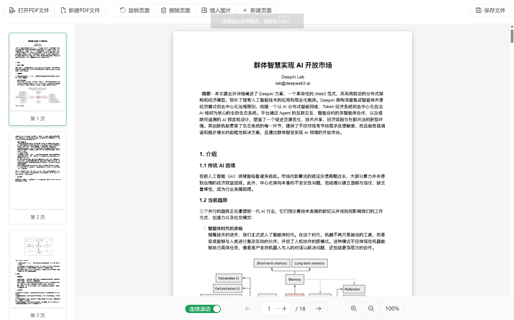

# PDF 助手

一个基于 **Vue 3 + Vite** 的纯前端 PDF 页面编辑器，无需上传服务器，所有操作均在浏览器本地完成，保护文档隐私。



## 功能特性

### 文件操作
- **打开 PDF**：本地选择 PDF 文件，即开即用
- **新建 PDF**：一键创建空白 PDF 文档

### 页面编辑
- **旋转页面**：支持 90° / 180° / 270° / 360° 旋转当前页
- **删除页面**：删除当前页，带二次确认，防止误操作
- **新建页面**：自定义插入位置（当前页前/后、文档开头/末尾）、纸张大小（A3 / A4 / A5 / Letter / Legal）及横向/纵向方向
- **插入图片**：将本地图片（JPG / PNG）作为整页插入文档

### 视图与导航
- **缩略图导航**：左侧页面缩略图栏，懒加载渲染，点击快速跳转
- **双浏览模式**：连续滚动 / 单页显示 一键切换
- **翻页控制**：前后翻页按钮 + 页码直接输入
- **缩放**：50% ~ 200% 缩放，支持"适应页面 / 适应宽度"
- **保存下载**：编辑完成一键导出修改后的 PDF

## 技术栈

| 模块 | 说明 |
|---|---|
| Vue 3 + Vite | 前端框架与构建工具 |
| [pdfjs-dist](https://github.com/mozilla/pdf.js) | PDF 渲染与读取（Canvas 渲染、缩略图） |
| [pdf-lib](https://github.com/Hopding/pdf-lib) | PDF 写入与修改（增删页面、旋转、嵌入图片） |
| Naive UI | UI 组件库 |

所有编辑操作走同一条链路：`pdf-lib` 修改文档 → 重新加载 → `pdf.js` 渲染预览。

## 快速开始

```bash
# 安装依赖（需 Node.js 18+）
pnpm install

# 本地开发
pnpm dev

# 构建产物（输出到 dist/）
pnpm build

# 本地预览构建结果
pnpm preview
```

## 部署到 GitHub Pages

项目已内置 GitHub Actions 工作流（`.github/workflows/deploy.yml`），推送代码到 `main` 分支即可自动构建并发布到 GitHub Pages。

步骤：

1. 将仓库推送到 GitHub
2. 在仓库 **Settings → Pages → Build and deployment → Source** 中选择 **GitHub Actions**
3. 之后每次推送都会自动部署，访问地址为 `https://<用户名>.github.io/<仓库名>/`

> 构建使用相对路径 `base: './'`，因此无论仓库名是什么，部署在子路径下都能正常加载静态资源。

## 隐私说明

本项目为纯前端应用，PDF 文件只在浏览器内存中处理，**不会上传到任何服务器**。
